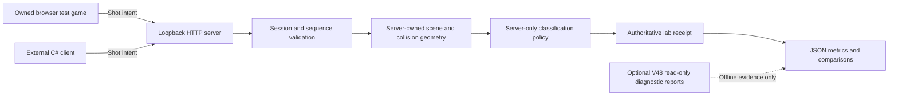

# Architecture and experiment contract



1. **Environment Analyzer** — `Program environment` reports host OS/process architecture, framework, pointer width and endianness. `FEASIBILITY.md` and the pinned V48 inventory interpret existing emulator evidence. It does not infer live Android state from host bitness or attach to BlueStacks.
2. **Position/Rotation Analyzer** — `Geometry.cs` implements validated double Vec math, unit quaternion rigid transforms and ray/sphere intersections. Owned mannequin centers are transformed from local to world coordinates on the server. Earlier Free Fire coordinates are evidence only and are not inserted into this scene.
3. **Hit Registration Engine** — `Geometry.First` chooses the nearest region along a finite ray. Server wall clipping runs before acceptance. Six spheres approximate head, chest, shoulder, stomach, arm and leg; these are deliberate experiment regions, not recovered commercial hitboxes. `Geometry.Projectile` supports a bounded, piecewise-linear ballistic experiment, not live network adjudication.
4. **External Interface** — separate `client` mode is a Windows-capable C# console process. `ExternalClient` requests the scene, obtains an issued session, sends shot intent over loopback HTTP and persists receipts. Only literal `127.0.0.1` HTTP endpoints are accepted. No host DLL/game-memory transport is linked.
5. **Server Validation Lab** — `Authority` owns origin, range, target geometry, revision and configurable startup policy. It normalizes finite nonzero directions, validates session/sequence and determines collision. `LabServer` hosts health, scene, session, shot, read-only policy and browser routes. Body conversion happens here after a valid collision, never by trusting a claimed client region.
6. **Verification/Reporting** — `Tests` tests math, policy and real HTTP behavior; `Client.Experiment` records six center-targeted intents, receipt details, geometric agreement, policy agreement, claim disagreements and RTT. See `VERIFICATION.md` for interpretation and limitations.

## Protocol

| Method/route | Request | Response |
|---|---|---|
| GET `/` | — | Owned test game HTML |
| GET `/health` | — | Readiness and owned-lab scope |
| GET `/scene` | — | Server origin, six boxes, range, wall flag, revision |
| GET `/policy` | — | Read-only server policy and delay |
| POST `/session` | Empty/unused body | New random session GUID, expires after 5 minutes |
| POST `/shot` | JSON `session`, strictly increasing positive `sequence`, finite nonzero `direction`, optional `claimedRegion` | Accepted flag, reason, geometric region, awarded region, echoed claim, claim/geometry agreement, damage, scene revision |

One shot JSON, with values for the **owned** scene:

```json
{"session":"SERVER-ISSUED-GUID","sequence":1,"direction":{"x":0,"y":0.28,"z":6},"claimedRegion":"Head"}
```

The server has origin `(0,1.2,-6)` and recomputes this ray against chest geometry. In geometric mode it awards Chest even when claim=Head. In convert mode it records geometry=Chest and award=Head. Client supplies neither hit point nor collider ID nor classification policy. Rejected requests do not award damage. Sequence is consumed for valid-session intents even if miss/invalid direction; replay cannot turn them into new damage.

The scene is static with revision `owned-static-v1`; it is not a tick history. The server does not trust any client timestamp for rewind. Position/rotation/target scene changes would need a versioned snapshot/tick contract before extending this wire protocol. Receipt damage is an experimental scalar (100 Head, 25 other regions), not a commercial weapon's damage or persistent health update.

## Reliability and concurrency

JSON request body maximum is 4096 bytes, including chunked requests, with a 3-second read timeout. Session count is capped at 1000; expired sessions are swept on issuance. Invalid JSON returns an error and the service stays healthy. The authority lock serializes state changes; the minimal HTTP loop itself processes requests serially. RTT therefore includes queue and processing time and injected delay. It is not a high-load or secure multiplayer server.

Mapping change handling, VM plug-in life cycle, SDK locks, native callbacks and anti-cheat behavior are outside this server; keeping those dependencies out makes these experiments reproducible. A later read-only import should have a typed evidence adapter, not raw pointers or arbitrary dynamic-library calls.
